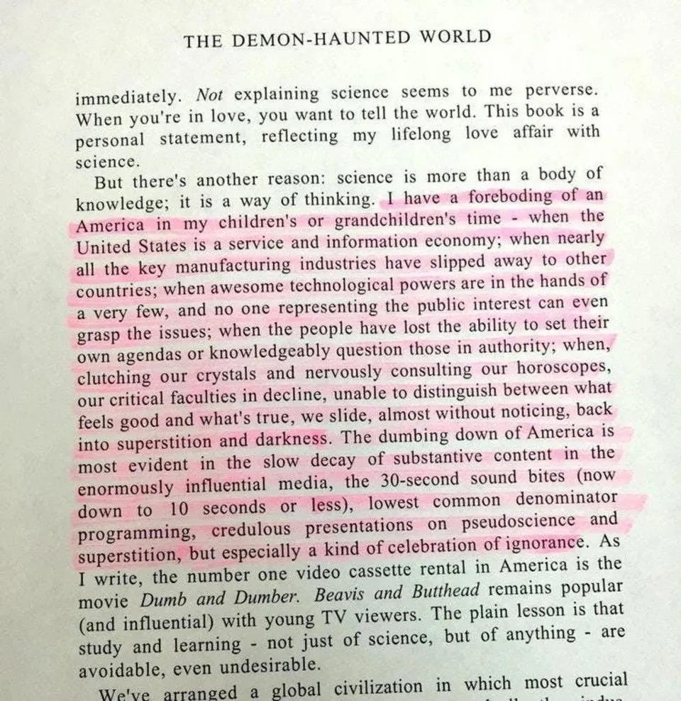

# Carl Sagan's 1995 Warning on America's Future Resurfaces

A passage from Carl Sagan's *The Demon-Haunted World* (1995) is circulating again. Sagan writes of a "foreboding" of an America in his children's or grandchildren's time: a service and information economy, key manufacturing gone abroad, "awesome technological powers" in the hands of a very few with no one representing the public interest able to grasp the issues, and people unable to "distinguish between what feels good and what's true" who slide "back into superstition and darkness". He points to the "dumbing down" of media: shrinking sound bites, lowest-common-denominator programming, and "a kind of celebration of ignorance".

*The passage, highlighted, from the opening chapter of The Demon-Haunted World (Carl Sagan, 1995).*

## Video

Short clip (about 70 seconds) of the prediction, posted by [@Saganismm on X](https://x.com/Saganismm/status/2114049076417474774) in October 2026 ("made 31 years ago").

<video controls preload="metadata" width="640" src="images/carl-sagan-1995-warning/sagan-prediction.mp4"></video>

## Why it matters

Ties to [[Wisdom - a practical capacity to choose a good path|wisdom]] themes: the problem Sagan names is less a lack of information than a loss of collective capacity to think and question, while technological power concentrates.
