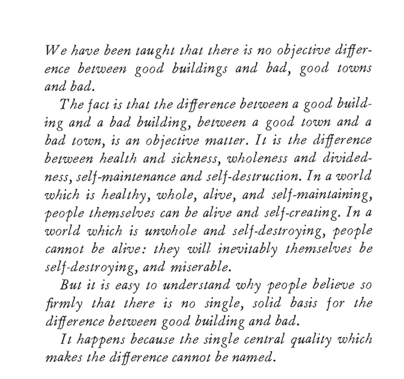
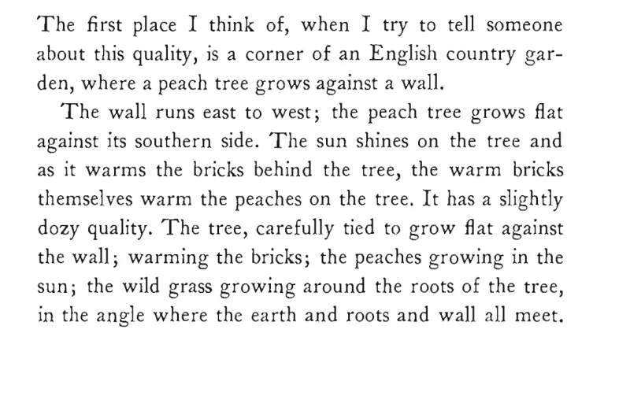
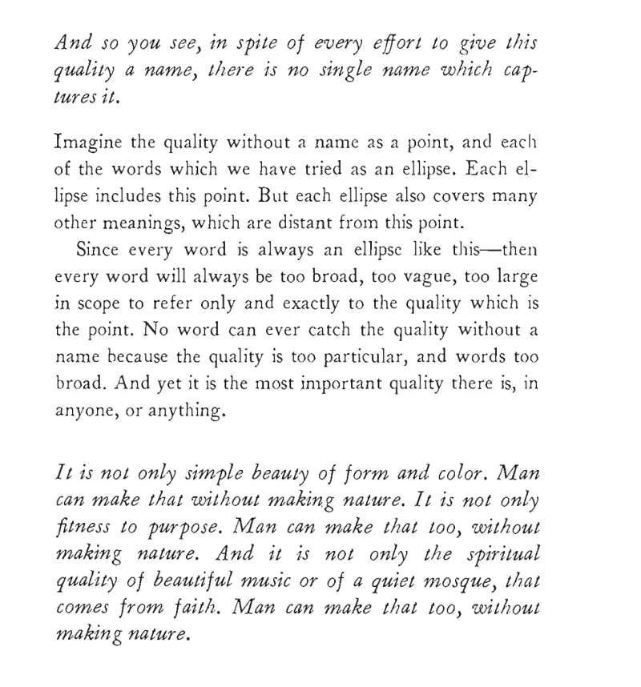
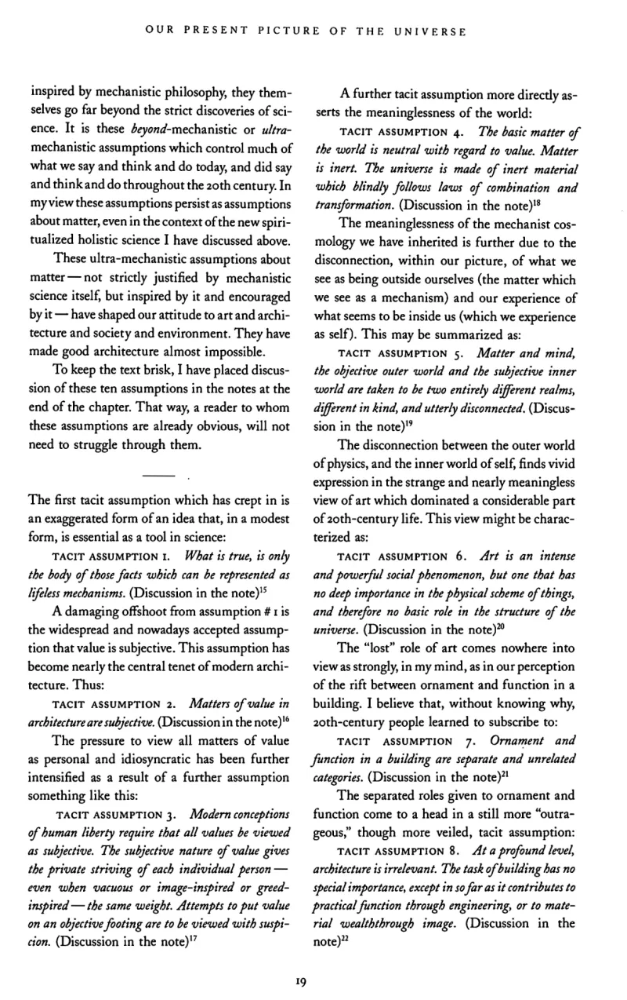
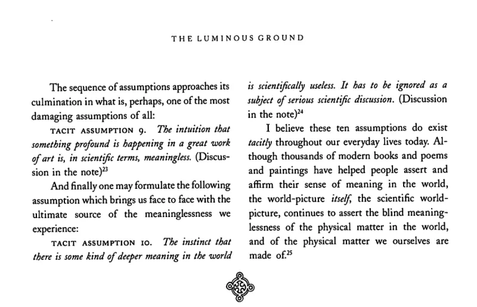

# Christopher Alexander

🌱 **Seed** — a place to keep Alexander's own words on the objectivity of value. Biography and the wider work still to add.

Christopher Alexander (1936–2022) was an architect and design theorist, author of *A Pattern Language* (1977), *The Timeless Way of Building* (1979) and the four-volume *The Nature of Order* (2002–05). For me he is the clearest and most concrete case of what I'd call **value realism**: the claim that value is real, not a projection of individual taste. His version is about buildings and towns. Good and bad in the built environment is, he says, "an objective matter", the difference between life and its absence, and it turns on a *timeless quality* that can't be pinned to a single name.

I come back to these passages often, so here they are, with the pages as I read them. Both are, in effect, Alexander stating the philosophy plainly: first *that* the quality is real and objective (*The Timeless Way of Building*), then *why* we've been taught not to see it (*The Nature of Order*, Book 4, *The Luminous Ground*).

See also:
- The case study of Alexander in [Wisdom, Value and Choice](https://secondrenaissance.net/papers/wisdom), where these excerpts also appear as Appendix III.
- [[Seeing the difference between paradigms - using the built environment]]
- [[What is valueception? And how does it contrast with what we normally mean by value?|Valueception]]

## The Timeless Way of Building

### An objective difference, and a quality without a name

From *The Timeless Way of Building* (1979), ch. 2, "The Quality Without a Name", p. 25.

> *We have been taught that there is no objective difference between good buildings and bad, good towns and bad.*
>
> *The fact is that the difference between a good building and a bad building, between a good town and a bad town, is an objective matter. It is the difference between health and sickness, wholeness and dividedness, self-maintenance and self-destruction. In a world which is healthy, whole, alive, and self-maintaining, people themselves can be alive and self-creating. In a world which is unwhole and self-destroying, people cannot be alive: they will inevitably themselves be self-destroying, and miserable.*
>
> *But it is easy to understand why people believe so firmly that there is no single, solid basis for the difference between good building and bad.*
>
> *It happens because the single central quality which makes the difference cannot be named.*

### The peach tree

His first example of the quality, from the same chapter.

> The first place I think of, when I try to tell someone about this quality, is a corner of an English country garden, where a peach tree grows against a wall.
>
> The wall runs east to west; the peach tree grows flat against its southern side. The sun shines on the tree and as it warms the bricks behind the tree, the warm bricks themselves warm the peaches on the tree. It has a slightly dozy quality. The tree, carefully tied to grow flat against the wall; warming the bricks; the peaches growing in the sun; the wild grass growing around the roots of the tree, in the angle where the earth and roots and wall all meet.

### Why no single word will do

> *And so you see, in spite of every effort to give this quality a name, there is no single name which captures it.*
>
> Imagine the quality without a name as a point, and each of the words which we have tried as an ellipse. Each ellipse includes this point. But each ellipse also covers many other meanings, which are distant from this point.
>
> Since every word is always an ellipse like this—then every word will always be too broad, too vague, too large in scope to refer only and exactly to the quality which is the point. No word can ever catch the quality without a name because the quality is too particular, and words too broad. And yet it is the most important quality there is, in anyone, or anything.
>
> *It is not only simple beauty of form and color. Man can make that without making nature. It is not only fitness to purpose. Man can make that too, without making nature. And it is not only the spiritual quality of beautiful music or of a quiet mosque, that comes from faith. Man can make that too, without making nature.*

## The Nature of Order, Book 4: The Luminous Ground

### Ten tacit assumptions that make good architecture almost impossible

From *The Nature of Order*, Book 4, *The Luminous Ground* (2004), ch. 1, "Our Present Picture of the Universe", section 7, pp. 19–20. The ten assumptions are what Alexander thinks stand between us and seeing the quality above.

> These ultra-mechanistic assumptions about matter — not strictly justified by mechanistic science itself, but inspired by it and encouraged by it — have shaped our attitude to art and architecture and society and environment. They have made good architecture almost impossible.
>
> To keep the text brisk, I have placed discussion of these ten assumptions in the notes at the end of the chapter. That way, a reader to whom these assumptions are already obvious, will not need to struggle through them.
>
> *   *   *
>
> The first tacit assumption which has crept in is an exaggerated form of an idea that, in a modest form, is essential as a tool in science:
>
> **TACIT ASSUMPTION 1.** *What is true, is only the body of those facts which can be represented as lifeless mechanisms.* (Discussion in the note)
>
> A damaging offshoot from assumption # 1 is the widespread and nowadays accepted assumption that value is subjective. This assumption has become nearly the central tenet of modern architecture. Thus:
>
> **TACIT ASSUMPTION 2.** *Matters of value in architecture are subjective.* (Discussion in the note)
>
> The pressure to view all matters of value as personal and idiosyncratic has been further intensified as a result of a further assumption something like this:
>
> **TACIT ASSUMPTION 3.** *Modern conceptions of human liberty require that all values be viewed as subjective. The subjective nature of value gives the private striving of each individual person — even when vacuous or image-inspired or greed-inspired — the same weight. Attempts to put value on an objective footing are to be viewed with suspicion.* (Discussion in the note)
>
> A further tacit assumption more directly asserts the meaninglessness of the world:
>
> **TACIT ASSUMPTION 4.** *The basic matter of the world is neutral with regard to value. Matter is inert. The universe is made of inert material which blindly follows laws of combination and transformation.* (Discussion in the note)
>
> The meaninglessness of the mechanist cosmology we have inherited is further due to the disconnection, within our picture, of what we see as being outside ourselves (the matter which we see as a mechanism) and our experience of what seems to be inside us (which we experience as self). This may be summarized as:
>
> **TACIT ASSUMPTION 5.** *Matter and mind, the objective outer world and the subjective inner world are taken to be two entirely different realms, different in kind, and utterly disconnected.* (Discussion in the note)
>
> The disconnection between the outer world of physics, and the inner world of self, finds vivid expression in the strange and nearly meaningless view of art which dominated a considerable part of 20th-century life. This view might be characterized as:
>
> **TACIT ASSUMPTION 6.** *Art is an intense and powerful social phenomenon, but one that has no deep importance in the physical scheme of things, and therefore no basic role in the structure of the universe.* (Discussion in the note)
>
> The “lost” role of art comes nowhere into view as strongly, in my mind, as in our perception of the rift between ornament and function in a building. I believe that, without knowing why, 20th-century people learned to subscribe to:
>
> **TACIT ASSUMPTION 7.** *Ornament and function in a building are separate and unrelated categories.* (Discussion in the note)
>
> The separated roles given to ornament and function come to a head in a still more “outrageous,” though more veiled, tacit assumption:
>
> **TACIT ASSUMPTION 8.** *At a profound level, architecture is irrelevant. The task of building has no special importance, except in so far as it contributes to practical function through engineering, or to material wealth through image.* (Discussion in the note)

> The sequence of assumptions approaches its culmination in what is, perhaps, one of the most damaging assumptions of all:
>
> **TACIT ASSUMPTION 9.** *The intuition that something profound is happening in a great work of art is, in scientific terms, meaningless.* (Discussion in the note)
>
> And finally one may formulate the following assumption which brings us face to face with the ultimate source of the meaninglessness we experience:
>
> **TACIT ASSUMPTION 10.** *The instinct that there is some kind of deeper meaning in the world is scientifically useless. It has to be ignored as a subject of serious scientific discussion.* (Discussion in the note)
>
> I believe these ten assumptions do exist *tacitly* throughout our everyday lives today. Although thousands of modern books and poems and paintings have helped people assert and affirm their sense of meaning in the world, the world-picture *itself*, the scientific world-picture, continues to assert the blind meaninglessness of the physical matter in the world, and of the physical matter we ourselves are made of.
