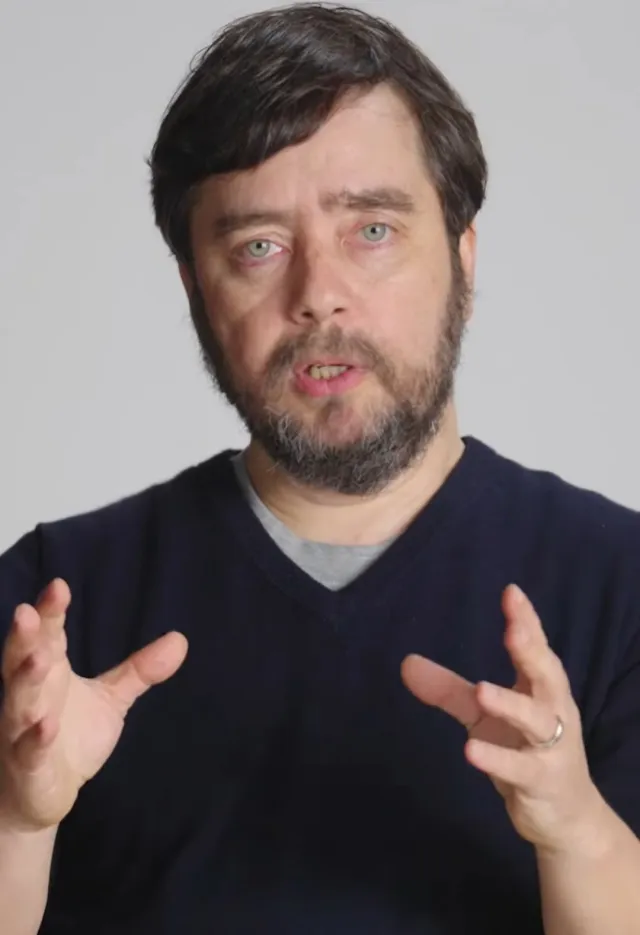

# Michael Levin

🌱 **Seed** — first pass from a research session. Citations checked against abstracts, not full texts; the judgements on strength of evidence are mine.

*Michael Levin in 2024. Photo: John Templeton Foundation, [CC BY 3.0](https://creativecommons.org/licenses/by/3.0), via [Wikimedia Commons](https://commons.wikimedia.org/wiki/File:Michael_Levin_2024.jpg).*

**The question:** what is Michael Levin claiming, how well does the evidence support it, and why is it so influential right now?

**Short answer:** Levin is a developmental biologist who argues that cells talk to each other through bioelectric signals, and that this layer stores the "goal" shape of a body. Read or rewrite it and you can change anatomy (heads, eyes, limbs, tumours) without editing genes. The lab results are mostly solid. The theory built on them is a bold research program. The metaphysics is speculation. He's popular now because he speaks to AI, longevity and consciousness all at once, with vivid experiments to show for it.

Why I care: it bears directly on mind, meaning and how complex systems pursue goals, which are core Life Itself themes. Possible essay later.

## The research program

- **Who:** professor at Tufts, where he directs the Allen Discovery Center and the Tufts Center for Regenerative and Developmental Biology.
- **Core thesis:** all cells, not just neurons, hold voltage differences and share them through gap junctions. The genome is *hardware*, a parts list. The bioelectric pattern is *software*: it stores the target body plan that cells work towards.
- **Three layers**, worth keeping apart:
  1. Lab science: bioelectric control of development and regeneration.
  2. Theory: the "bioelectric code", cognition in cells and tissues.
  3. Metaphysics: mind everywhere, a "Platonic space" of forms.

## What the lab has shown, and how solid it is

**Solid** (peer-reviewed, with some independent support)

- *Bioelectricity matters in development*, and not just in his lab. Ion-channel mutations cause body-shape defects in humans (e.g. Andersen-Tawil syndrome, from KCNJ2), and potassium-channel mutants in zebrafish grow longer fins.
- *Two-headed planaria.* Blocking gap junctions gives two-headed worms, and fragments of those worms *stay* two-headed when cut again, with the genome unchanged (Oviedo et al. 2010; Durant et al. 2017).
- *Eyes outside the head.* Setting a voltage pattern in tadpoles triggers eyes to grow elsewhere, even on the gut (Pai et al. 2012).
- *Xenobots exist and do what the papers say* (PNAS 2020, 2021). They are built from frog embryo cells, with shapes designed by evolutionary algorithms in simulation. Cilia drive their movement.

**Real but more limited than the headlines**

- *Frog leg regrowth* (Murugan et al. 2022): a 24-hour drug cocktail on adult frogs led to substantial, working, but not fully normal regrowth over 18 months. The cocktail isn't purely bioelectric.
- *Cancer "normalization":* tumour-like growths suppressed by changing cell voltage. Tadpole models only.
- *Xenobot "self-replication":* they push loose cells into piles that become new bots. Clever, but it needs a supply of free cells, and "robot" is framing.
- *Anthrobots* (2023): self-assembling bots made from human airway cells that move and help scratched neuron sheets repair in a dish. A modest, early result.

**Weak or contested**

- *Planarian memory surviving decapitation* (Shomrat & Levin 2013): worms with regrown heads relearned faster (a "savings" effect), not instant recall. Often cited, rarely replicated.
- *Instructive vs permissive:* does voltage carry its own information, or does it act through known pathways (Wnt, serotonin, calcium)? Unresolved.
- *The "bioelectric code"* as stored, rewritable target anatomy: a strong, testable hypothesis, with much of the support from his own lab.
- *Learning in gene networks and "cognition" in cells:* mostly computational models, or experiments re-described in cognitive terms.

**Caveats overall**

- Many key results come from one big, very productive lab and its collaborators. Independent replication is thinner than the fame suggests.
- No human treatment yet. Astonishing Labs, a startup he is affiliated with, is aimed at that.
- The data are usually fine. The words (robots, memory, goals, mind) do a lot of extra work.

## The big ideas built on it

- **TAME** (Technological Approach to Mind Everywhere): cognition comes in degrees, not yes/no. Molecules, cells, tissues, organisms and swarms each have some ability to pursue goals.
- **Cognitive light cone:** the size, in space and time, of the goals an agent can pursue. Cancer is cells whose light cone shrinks back to "just me".
- **Multiscale competency:** life is nested problem-solving layers. The genome sets the hardware; goal-seeking at every level does the rest.
- **Platonic space:** recent framing that mind may be older than the brain, with forms and patterns that physical systems "tap into".

## Why it's catching on now

- **The AI moment.** Everyone is asking what intelligence is. "Mind comes in degrees, in many substrates" gives a frame beyond brains vs LLMs.
- **Vivid results.** Two-headed worms and living machines make videos, not just arguments, which most consciousness theorists lack.
- **Longevity and biotech money.** Regrowing organs and treating cancer by fixing the body's electrical plan pull in investors.
- **The podcast circuit.** Lex Fridman (several times), Tim Ferriss (Jan 2026), Sean Carroll, Curt Jaimungal and others. Calm, deep, long-form interviews suit him.
- **Crosses fields.** Biology, computer science, philosophy of mind and even spirituality. The Platonic ideas appeal to meditators without asking them to give up science.
- **Counters gene-centrism.** After decades of "DNA is the blueprint", "the genome is hardware" feels like a paradigm shift.
- **Temperament.** Humble, prolific and generous with ideas. He makes big claims but calls them hypotheses.

## Where to start

- Paper: Levin, "Technological Approach to Mind Everywhere: An Experimentally-Grounded Framework for Understanding Diverse Bodies and Minds", *Frontiers in Systems Neuroscience* (2022).
- [Tim Ferriss Show episode](https://tim.blog/2026/01/21/dr-michael-levin/) (Jan 2026).
- [Interview in The Biologist](https://thebiologist.rsb.org.uk/biologist-features/professor-michael-levin-interview).
- [Mind may be older than the brain](https://lifeboat.com/blog/2026/06/mind-may-be-older-than-the-brain-michael-levin-on-life-and-intelligence) (2026).
- His blog [Thoughtforms](https://thoughtforms.life), and the [Levin lab site](https://drmichaellevin.org).
- [Wikipedia](https://en.wikipedia.org/wiki/Michael_Levin_(biologist)).
