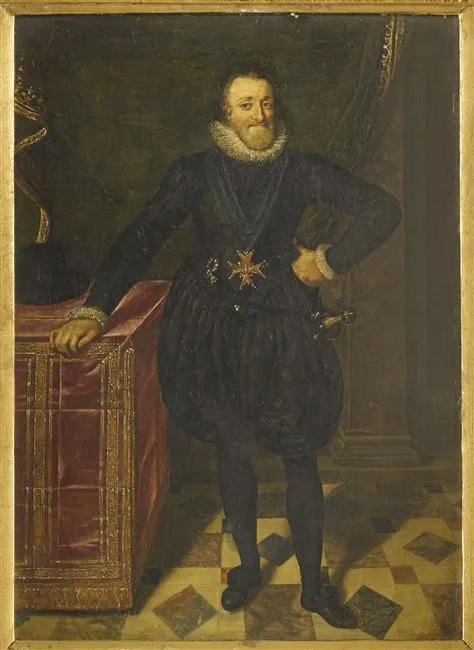

# The Democrats won. The culture war isn't over.

After this month's Democratic victory, a lot of people I know are breathing a sigh of relief: *we're back, it's all okay*.

I understand the feeling. But I don't think it is okay, or at least not in the way people hope. I think this is an interlude in a long culture war, really a slow-motion civil war, that will run for years yet and resolve one way or the other.

My guide to this is the last time it happened: the Wars of Religion in 16th-century France.

## The last culture war

The Protestant–Catholic conflict was a culture war between **modernity and premodernity**. Protestantism carried the seeds of the modern: salvation through your own faith, by your own reading of the Bible, a "priesthood of all believers". Catholicism carried the premodern: salvation through the Church, its hierarchy and its sacraments. If going to heaven is the most important thing in your life, that difference is not academic. It is existential.

Ours is a culture war between **modernity and postmodernity**. The structure is strikingly similar. (I set out the full argument in [[What the French Wars of Religion tell us about today's culture war]], and the history in [[The French Wars of Religion in ten minutes]].)

## The "we won" moments didn't last

Here is what should give us pause. The French conflict was full of moments that felt like resolution.

- **1562:** the crown granted Protestants limited toleration. Within weeks, Catholic soldiers massacred Protestants at worship in Wassy, and war began.
- **1570–72:** a generous peace, then a royal wedding meant to unite the two sides. It ended in the St Bartholomew's Day Massacre: thousands killed in Paris, perhaps ten thousand or more across France.
- **1576:** an even more generous peace. Its answer was the Catholic League, a mass populist movement that would drive a king out of his own capital.
- **1589:** a Protestant became king. He had to convert to Catholicism to rule.
- **1598:** the Edict of Nantes, the great settlement. It lasted 87 years. In 1685 Louis XIV revoked it, outlawed Protestantism and drove 200,000 people into exile.

Lasting toleration came only in 1787–89, more than two centuries after the first persecutions.

Two things stand out. First, the oscillations: toleration, backlash, toleration, backlash, again and again. Second, it was often the *most generous* victories that triggered the fiercest reaction.

## The new creates its own reaction

The rise of Protestantism did not just meet existing conservatism. It *manufactured* reaction. Ordinary Catholics became militants. The Church rebuilt itself as a fighting force: the Jesuits, the Inquisition, the Council of Trent. The Jesuits were strikingly modern in their methods (schools, organisation, media) while defending the old order.

We see the same today. The rise of postmodern values has produced not just old-style conservatism but something newer and more militant: traditionalists allied with what Jeffrey Herf called **reactionary modernists**, people who embrace technology while rejecting liberal, egalitarian values. Think Musk and much of the tech right. Trump's achievement was to knot these together into a coalition that can win.

That coalition has not gone away because it lost an election. Neither have the forces that created it.

## Both sides keep polarising

In France, each side split internally: moderate and radical Protestants; open-minded Catholics like Montaigne, and hardline Leaguers and assassins. The conflict kept pulling each side toward its extremes. The same is happening now, on both sides.

## What this means now

If the analogy holds — and like all analogies it is imperfect — then:

- **Don't mistake a win for a resolution.** This looks more like the toleration edict of 1562 than the Edict of Nantes, and even Nantes didn't last.
- **Expect backlash, especially to overreach.** Generous victories may provoke the fiercest response.
- **The root is not electoral.** It is a clash of paradigms, what I call the [[metacrisis]]. Elections are the surface.
- **The outcome is open.** In France the Protestants lost, yet modernity won, through other countries and eventually through the Enlightenment. A paradigm can win by routes neither faction expects.

So yes, enjoy the relief. Then get back to the real work. The question is not who wins the next election. It is whether we can find, faster this time and with far less bloodshed, the deeper settlement that lets a new paradigm emerge. That is what I mean by a [[Second Renaissance]].

*Henri IV: the Protestant who became king, converted to rule, and issued the Edict of Nantes. Assassinated by a Catholic zealot in 1610; his edict was revoked 75 years later. Painting: Frans Pourbus the Younger (1610), Musée Condé. Public domain, via [Wikimedia Commons](https://commons.wikimedia.org/wiki/File:Portrait_d%27Henri_IV_-_Frans_Pourbus_-_Mus%C3%A9e_Cond%C3%A9.jpg).*
