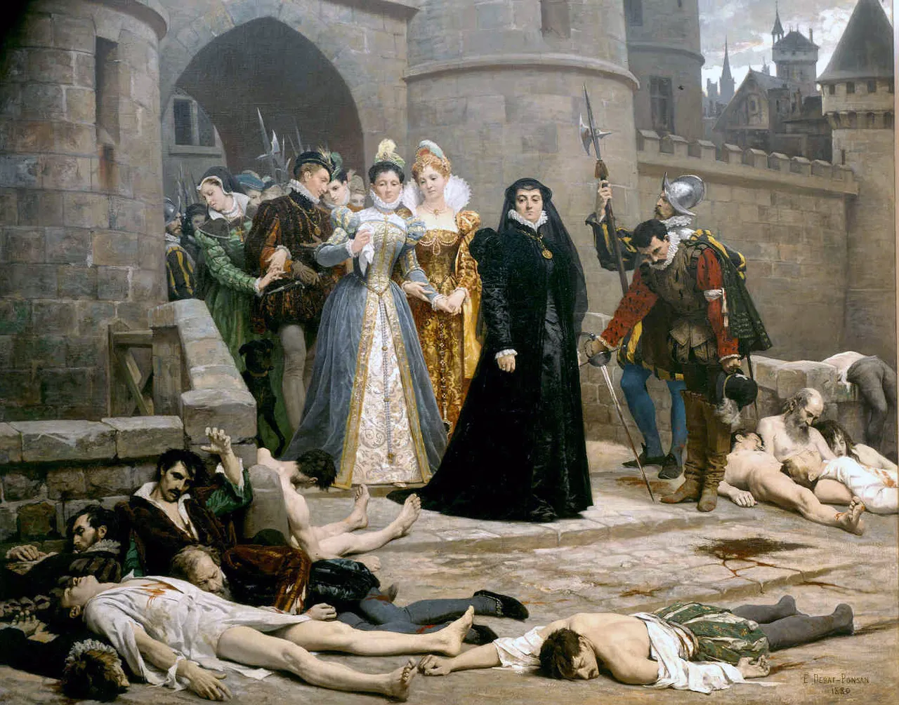
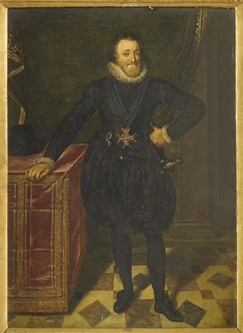
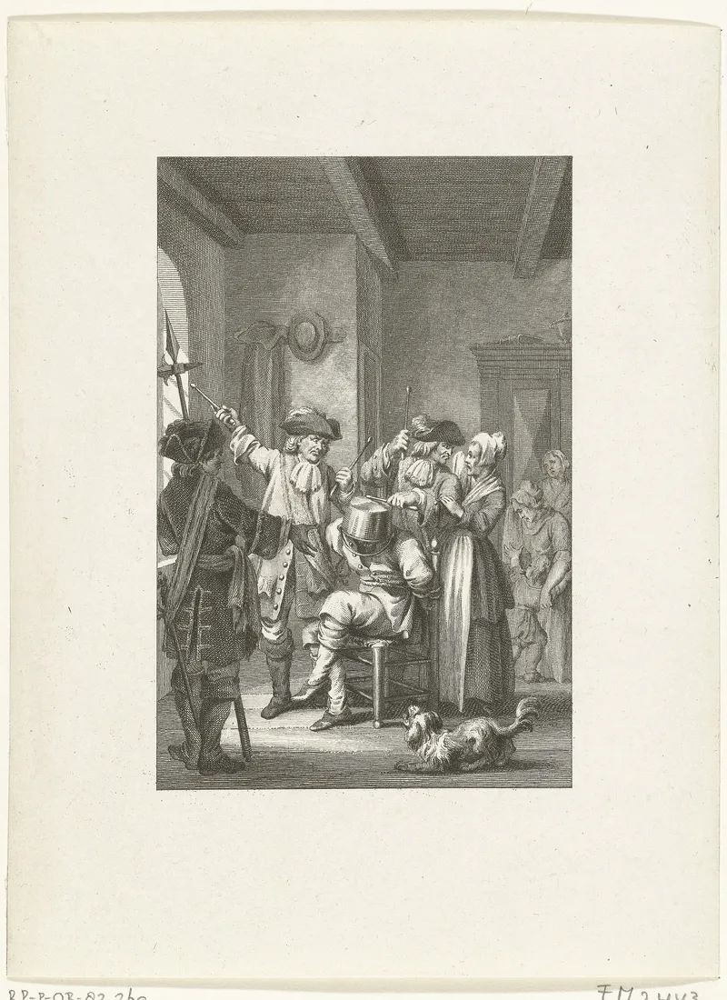

# The French Wars of Religion in ten minutes

*"A morning at the gates of the Louvre": Catherine de' Medici and the court inspect the dead after St Bartholomew's night. Painting: Édouard Debat-Ponsan (1880). Public domain, via [Wikimedia Commons](https://commons.wikimedia.org/wiki/File:Debat-Ponsan-matin-Louvre.jpg).*

A companion to [[What the French Wars of Religion tell us about today's culture war]], where I argue these wars are the best guide to our own culture war. This is the history in brief.

## Background

- **The Reformation** began with Luther in 1517. French Protestants — the **Huguenots** — were Calvinists; Calvin, a Frenchman, ran Geneva from 1541.
- **Persecution** began after the Affair of the Placards (1534), when anti-Mass posters went up in Paris, and intensified under Henry II (1547–59).
- **At their peak** (c. 1560) Huguenots were about 10% of the population — perhaps 1.5–2 million people — but a much larger share of the nobility and the educated urban classes.
- **Across Europe** the same conflict was playing out: the Peace of Augsburg (1555), the Dutch Revolt (from 1568), and later the Thirty Years' War (1618–48).

## The trigger (1559–62)

In 1559 Henry II died in a jousting accident. Three weak sons followed in turn — Francis II, Charles IX, Henry III — with their mother, **Catherine de' Medici**, as the power behind the throne. Noble factions filled the vacuum: the ultra-Catholic **Guise** against the Protestant **Bourbons** and **Admiral Coligny**.

Attempts at compromise failed. In January 1562 the crown issued an edict tolerating Protestant worship outside town walls. On 1 March the Duke of Guise's men killed about 50 Protestants at worship in a barn at **Wassy**. The first war began.

## Eight wars

| # | Dates | Key events | Ended by |
|---|---|---|---|
| 1 | 1562–63 | Battle of Dreux; Duke of Guise assassinated | Edict of Amboise |
| 2 | 1567–68 | Huguenots try to seize the king | Peace of Longjumeau |
| 3 | 1568–70 | Condé killed at Jarnac; Moncontour | Peace of Saint-Germain |
| 4 | 1572–73 | **St Bartholomew's Day Massacre**; siege of La Rochelle | Edict of Boulogne |
| 5 | 1574–76 | Moderate Catholics ally with Huguenots | Peace of Monsieur — generous, provoking backlash |
| 6 | 1576–77 | **Catholic League founded** | Peace of Bergerac |
| 7 | 1579–80 | The "Lovers' War" | Peace of Fleix |
| 8 | 1585–98 | War of the Three Henrys | **Edict of Nantes** |

The pattern: war, compromise, hardliner outrage, war again.

## St Bartholomew's Day (August 1572)

On 18 August the Protestant Henri of Navarre married Marguerite de Valois, the king's Catholic sister — a reconciliation that filled Paris with Huguenot nobility. On 22 August an assassin wounded Coligny. Fearing Protestant revenge, the crown ordered a pre-emptive strike on the Huguenot leaders on the night of 23–24 August. Coligny was killed, and the killing became a popular massacre. About 2,000–3,000 died in Paris; copycat massacres in a dozen cities continued into October, with a total of perhaps 5,000–10,000 or more.

The Pope celebrated with a *Te Deum* and a commemorative medal. Navarre survived by converting under duress, and escaped in 1576. Huguenot writers responded with theories that tyrants may be resisted and sovereignty rests with the people — early constitutionalism, later borrowed by the Catholic League against its own king.

## The climax: the League and the Three Henrys (1584–98)

In 1584 the Protestant Henri of Navarre became heir to the throne. For Catholics this was an existential crisis. The **Catholic League** — a mass, populist movement, strongest in Paris and funded by Spain — rose against it.

- **1588:** Paris rose for the Duke of Guise (the Day of the Barricades) and King Henry III fled. In December the king had Guise murdered at Blois.
- **1589:** a friar assassinated Henry III. Navarre became **Henri IV**, but most of Catholic France refused him.
- **1593:** after years of war, Henri converted to Catholicism ("Paris is well worth a Mass") and entered Paris in 1594.
- **1598:** the **Edict of Nantes** granted Protestants freedom of conscience, limited public worship, civil equality and around 150 fortified towns. A pragmatic truce, not toleration as a principle.

In all, perhaps 2–4 million people died from war, famine and disease.

*Henri IV, the Protestant who became king, converted, and issued the Edict of Nantes. Painting: Frans Pourbus the Younger (1610), Musée Condé. Public domain, via [Wikimedia Commons](https://commons.wikimedia.org/wiki/File:Portrait_d%27Henri_IV_-_Frans_Pourbus_-_Mus%C3%A9e_Cond%C3%A9.jpg).*

## The third force

The *Politiques* — moderates, mostly Catholic, including Michel de l'Hôpital, Jean Bodin and Montaigne — argued that civil peace and the state mattered more than religious truth. Their answer to religious civil war was a sovereign state above the sects, which grew into absolute monarchy. Henri IV was their king.

## The reversal (1598–1685)

- **1610:** Henri IV was assassinated by a Catholic zealot.
- **1627–28:** Cardinal Richelieu besieged the Protestant stronghold of La Rochelle; most of the city starved.
- **1629:** the Peace of Alès left Protestants their worship but stripped their fortresses and political privileges.
- **1681 onward:** under Louis XIV ("one king, one law, one faith"), the **dragonnades** — soldiers billeted in Protestant homes to terrorise families into converting.
- **1685:** the Edict of Fontainebleau revoked Nantes and outlawed Protestantism. Around 200,000 Huguenots fled to the Netherlands, England, Prussia, Switzerland and beyond, taking their skills with them.

*The dragonnades: soldiers billeted on Protestant households to force conversions, 1680s. Print, later 18th century. Rijksmuseum, CC0, via [Wikimedia Commons](https://commons.wikimedia.org/wiki/File:Dragonnades_in_Frankrijk,_ca._1681-1685,_RP-P-OB-82.260.jpg).*

## The long tail

Protestants rebelled in the Cévennes (the Camisards, 1702–04) and worshipped illegally in the "Church of the Desert". Voltaire's campaign over the Calas affair (1762–63) helped shift opinion. The Edict of Versailles (1787) restored Protestants' civil status, and the Declaration of the Rights of Man (1789) granted religious freedom. More than two centuries after the first persecutions, toleration finally stuck.
