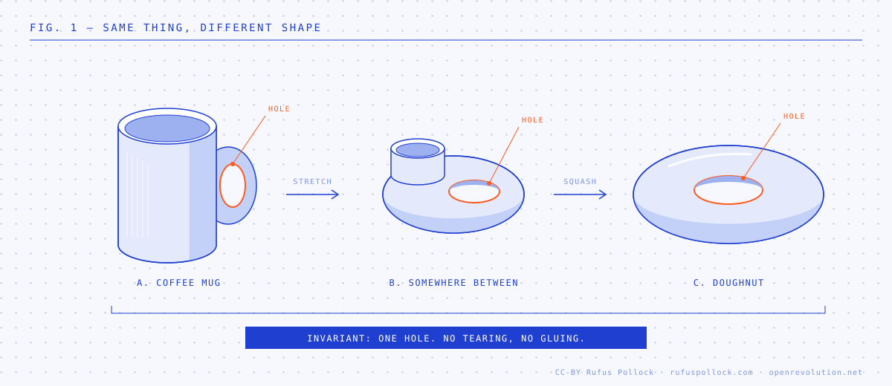
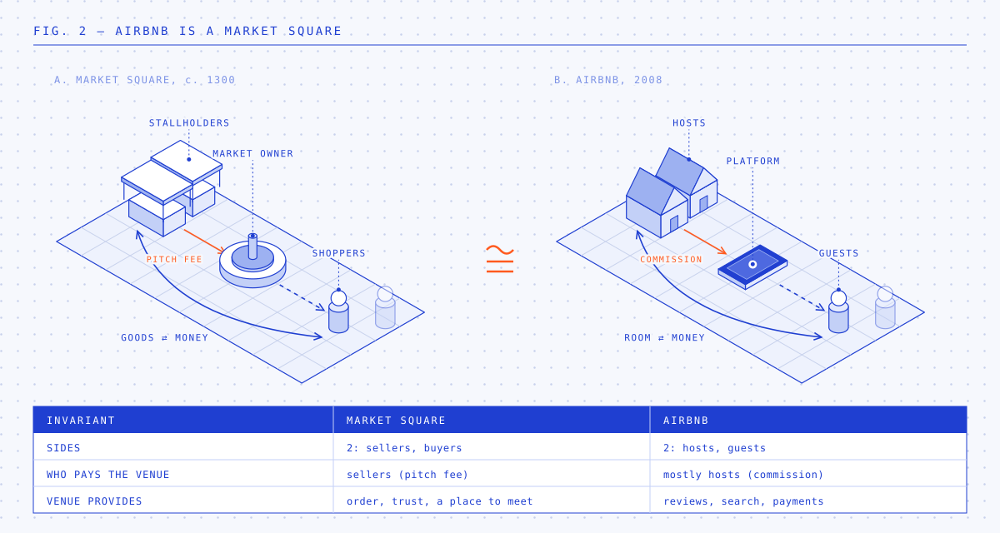

# The Mug, the Doughnut and the DAO

*Fig. 1. A coffee mug and a doughnut are the same thing to a topologist: stretch and squash one into the other without tearing or gluing, and the one hole survives throughout.*

Take a coffee mug made of clay. Deform it continuously (stretch, squash, bend, but never tear or glue) and you get a ring. The two are *homeomorphic*: the same object as far as topology is concerned. What survives every such deformation are the *invariants*, and for a surface the main one is the number of holes, the genus.

The classification theorem for surfaces makes this striking. Every closed orientable surface is homeomorphic to a sphere with some number of handles. A cube, a teapot and a human head (ignoring the nostrils) are all spheres; a mug is a torus; a pretzel is genus three. Infinite variety of shape, a very short list of kinds. (One dimension up, the Poincaré conjecture says the same for 3-manifolds: no holes, and you have a sphere.)

My claim: institutional design works the same way. There are a small number of institutional *kinds*. Most designs that look new are continuous deformations of one of them: different size, different shape, new technology, same topology. Not seeing this wastes a lot of effort, and leads people to claim innovation where there isn't any.

*Fig. 2. Airbnb is a market square. Same two sides, same venue in the middle, same fee from the sellers; only the technology has changed.*

## Invariants for institutions

To make the analogy do work, we need the institutional equivalent of genus: the properties that stay fixed however much you stretch the surface. A first list:

- **Who pays**, and who gets the service for free.
- **Who decides**, and how votes or voice are weighted.
- **Who owns**: who holds the residual claim and the right to exclude.
- **How many sides**: how many distinct groups the institution brings together, and which side subsidises which.

Change the technology, the branding, the scale or the interface and these usually don't move. Change one of these and you have a genuinely different institution.

## A worked example: Google is a newspaper

Google looks like nothing that came before it. A search box, an algorithm, a trillion-dollar company. Now look at the invariants.

There are three sides:

| | Newspaper | Free classifieds paper | Google |
|---|---|---|---|
| Readers | Get the paper cheap or free | Get the paper free | Search for free |
| Content | Journalists, paid by the paper | Listings, supplied free by users | Websites, supplied free; Google doesn't pay |
| Who pays | Advertisers | Advertisers | Advertisers |
| What is sold | Reader attention | Reader attention | Searcher attention |

Topologically, Google is a newspaper. More precisely it is a free classifieds paper: advertisers pay; readers get it free; and the content (other people's web pages, like other people's small ads) costs the publisher nothing. The search algorithm is a much better index, and the auction is a much better way to sell ad space. That is geometry: it changed the size and efficiency, not the shape.

Seeing it this way explains things that otherwise look like new phenomena:

- **Why newspapers collapsed.** Google (and Craigslist before it) didn't beat newspapers by being a different kind of thing. It was the same kind of thing, run more efficiently, *without the cost of paying for content*. The classifieds and display ads that cross-subsidised journalism moved to a three-sided platform that doesn't pay its content side. The money for journalism went with them.
- **Why the old conflicts reappear.** Newspapers always fought over the line between editorial and advertising. Google fights over the line between organic results and paid ones, and over how much of the page it keeps for its own answers (see [[The Google Tax]]). Same tension, same invariant (advertisers pay, readers don't), new clothes.
- **Why "platforms tend to one".** Positive feedback between the sides (more readers attract more advertisers, which fund more content, which attracts more readers) gave most cities one dominant paper. The same dynamic gives us one dominant search engine. I've written about this at length in [Platformnomics](https://openrevolution.net/platformnomics).

## Markets: Uber is a market square

Marketplaces come in only a few kinds: one-sided (a shop sells to you), two-sided (a venue brings buyers and sellers together) and three-sided (a third group, usually advertisers, pays to reach the other two, as with Google above).

Uber, Airbnb and eBay are two-sided markets (Fig. 2). So is a medieval fair, a fish market or a stock exchange. The venue brings buyers and sellers together, charges the sellers for a pitch, and keeps enough order that people trust the place. eBay is the market square online, Airbnb is it for spare rooms, Uber for car rides (with the old taxi rank and dispatch office as near relatives). The technology and the scale are new. The structure is not, and neither are the problems: who sets the stall fees, what happens when there is only one market in town, and the position of the people who work in it. I made this argument at length in [[ubernomics|Ubernomics]], and [Platformnomics](https://openrevolution.net/platformnomics) in Open Revolution has the long version, focused on two-sided platforms.

## Funding information: a short, closed list

The same goes for funding information commons: open data, open source, open research. People keep looking for a new funding model. The list of kinds is short (more in [Open Revolution](https://openrevolution.net/remuneration-rights) and its [FAQ](https://openrevolution.net/faq)):

- **State funding**: grants, procurement, levies.
- **Philanthropy and donation.**
- **Membership or club**: the users pool money to pay for what they share.
- **Monopoly rights**: patents and copyright, so the creator charges for access.
- **Cross-subsidy**: sell something complementary (services, hardware, attention) and give the information away.
- **Prizes and remuneration rights**: pay creators out of a common fund, by result or by usage.

Each comes in endless variants, and getting the variant right matters. In the spirit of honesty, the same test applies to my own proposal. Remuneration rights are, topologically, state-coordinated collecting societies: a pooled fund paid out by usage, which is a known kind. What is new is the combination: a patent-like right to be paid, funded from a pool, with the work itself open. That is about as close to genuine novelty as institutional design usually gets: gluing known pieces together in a new way.

But a pitch for a "new" funding model nearly always turns out to be a known one, stretched.

## Voting and governance: 2,000 years of deformations

Now for the bold version of the claim. In voting and governance structures, there has been very little topological innovation for something like 2,000 years. The basic kinds were all in play in the ancient world: rule by one, by a few or by many; direct assemblies and elected representatives; selection by lot (Athens); delegation; consensus; and votes weighted by wealth (Rome's centuriate assembly gave the rich more voting blocs, and they voted first).

Since then we have done a lot of geometry: bigger electorates, secret ballots, different counting rules, written constitutions. Valuable work, but variations on the same short list.

Which brings us to blockchain, where a great deal of governance innovation is claimed. Check the invariants:

- **Token-weighted voting** is one-share-one-vote, the joint-stock company, and before that Rome's wealth-weighted assembly.
- **A DAO** is a club, cooperative or company, with the articles of association written in code.
- **Liquid democracy** is proxy voting with revocable delegation.
- **A multisig** is a board or committee with a quorum rule.
- **"Code is law"** is an entrenched constitution, with smart-contract upgrades playing the part of the amendment procedure.

Some of these are useful deformations: cheaper, faster, more transparent. None of them changes an invariant. They are old models dressed in new digital clothes.

## Towards a topology of institutions

A short detour for the mathematically inclined; skip it if you like.

Topology's great trick was to stop asking "what shape is this?" and ask instead "what stays the same however I deform it?" Those are the invariants, and they turn out to be powerful.

The oldest example is Euler's formula. For any convex polyhedron (cube, pyramid, a football's panels) vertices minus edges plus faces is always 2: a cube gives 8 − 12 + 6, a tetrahedron 4 − 6 + 4. Why always 2? Because every one of them is a deformed sphere, and 2 is the sphere's number. Draw the same kind of net on a doughnut and you get 0. One number, and it sorts shapes into kinds.

From invariants come classification theorems. For surfaces the answer is complete: two numbers (the number of holes, and whether the surface has a consistent inside and outside) tell you exactly what kind of surface you have, and every possible combination is known. One dimension up, the Poincaré conjecture asked whether every closed three-dimensional space with no holes is a (three-dimensional) sphere. It took a century to prove; Grigori Perelman did it in 2003, and turned down both the Fields Medal and a million-dollar prize.

Institutional design has nothing like this, and I think it should try. The programme is the same:

1. **Choose the invariants**: who pays, who decides, who owns, how many sides.
2. **Show which changes are deformations**: new technology, new scale, new interface, new branding.
3. **Classify**: list the kinds that the invariants allow, and which are in use.

We won't get theorems. But even a rough classification would let us say of a new proposal, quickly and without argument, "that's a club" or "that's a newspaper", and focus attention on the rare proposals that change an invariant.

## So what?

None of this says the details don't matter. Topologists distinguish topology (what survives deformation) from geometry (actual size and shape), and in practice you live in the geometry. A mug whose handle is too small to hold is useless. Who pays how much, the exact voting rule, the default settings: these decide whether an institution works. Tweaking is real work.

But knowing the topology helps in three ways.

1. **It saves search.** If the list of kinds is short, stop looking for a new one and ask which known kind fits your problem, and how to shape it.
2. **It lets you borrow.** A design homeomorphic to an old one inherits the old one's history: its failure modes, its politics, what made it work. Google inherited the newspaper's conflicts. A DAO inherits the corporation's problems with concentrated ownership.
3. **It tells you what real novelty would take.** In topology the only way to change kind is to tear or glue: to add or remove a hole. In institutions, that means changing an invariant: who pays, who decides, who owns. A proposal that changes none of these is a deformation, however clever. That's worth knowing, whether you are designing one or being pitched one.

So when you meet a new institution, ask first: what is it homeomorphic to? Usually the answer is something old and well understood. Occasionally it isn't, and that is when to get excited.
