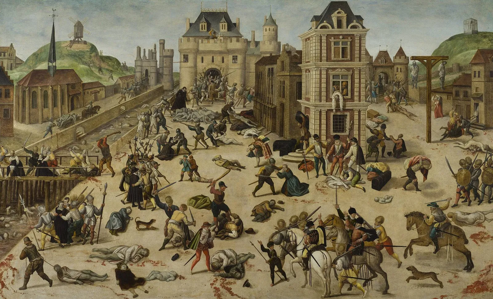

# What the French Wars of Religion tell us about today's culture war

*The St Bartholomew's Day Massacre, Paris, 24 August 1572. Painting: François Dubois (c. 1572–84), Musée cantonal des Beaux-Arts, Lausanne. Public domain, via [Wikimedia Commons](https://commons.wikimedia.org/wiki/File:La_masacre_de_San_Bartolom%C3%A9,_por_Fran%C3%A7ois_Dubois.jpg).*

It is the small hours of Sunday, 24 August 1572, and Paris is hot and crowded. The city is full of Protestant nobles, come for the wedding that was supposed to end ten years of civil war: their leader, Henri of Navarre, married the king's Catholic sister six days ago. Just before dawn the bell of Saint-Germain-l'Auxerrois begins to ring. Armed men force their way into the lodgings of Admiral Coligny, the greatest Protestant commander in France. They stab him and throw his body from the window into the courtyard, where the young Duke of Guise is waiting to see it done. Then the killing spreads beyond the soldiers. By morning, ordinary Parisians are hunting their neighbours through the streets, and the Seine is carrying bodies.

Around 3,000 people died in Paris, and perhaps 10,000 or more across France as the massacres spread to other cities. The Pope had a *Te Deum* sung in celebration.

I keep coming back to this moment because I think the French Wars of Religion are the best guide we have to what we are living through now. They were a culture war between **modernity and premodernity**. Ours is a culture war between **modernity and postmodernity**. The structure is strikingly similar — and so are the lessons.

(For the history in brief, see my companion piece: [[The French Wars of Religion in ten minutes]].)

## A paradigm war, not a doctrinal squabble

It is easy today to wonder how people could kill each other over theology. But consider what was at stake. If the most important thing in your world is being saved and going to heaven, then *how* that happens is the most important question there is. Are you saved through the Church — its priests, its sacraments, its hierarchy? Or by your own faith, through your own reading of the Bible? That is not a technicality. It is existential.

And underneath that question were two paradigms. **Protestantism carried the seeds of modernity**: individualist (salvation by faith alone), egalitarian (the "priesthood of all believers"), and it democratised reason — read the book yourself, in your own language. **Catholicism represented premodernity**: hierarchical, institutional, mediated. Not unintelligent — but it did not want ordinary people reading the Bible in the vernacular, and by the 1500s the vibrant scholasticism of the 13th century had largely ossified.

Modern did not yet mean secular — Calvin's Geneva was a theocracy. But the core features of modernity are there. And they spread beyond Protestants: Descartes was a Catholic, educated by Jesuits, and a thoroughgoing modernist.

## Lesson 1: the rise of the new manufactures reaction

Protestantism did not just meet existing Catholic conservatism. It *created* reaction. Ordinary Catholics who had never thought much about theology became militants. The Church reinvented itself as a fighting force: the Jesuits as shock troops of education and influence, the Inquisition and the Index of Forbidden Books, the Council of Trent redefining Catholicism explicitly *against* Protestantism. In France this became the Catholic League — mass, urban, populist, fired up by preachers and pamphlets.

The irony: the Jesuits were extremely modern in their methods — schools, organisation, media, global reach — all in the service of defending the old order.

That is what I see today. The rise of postmodern values provokes a reaction that is not simply old conservatism but something new and militant. It comes in two flavours: religious and cultural traditionalists, and what Jeffrey Herf called **reactionary modernists** — people who embrace technology and the machinery of modernity while rejecting its liberal, egalitarian spirit. Think Musk and much of the tech right. Trump's achievement has been to knot these two together into a coalition that can win, and that can resist the rising postmodern tide. (More in [[Trump, Neo-fascism and the Crisis of Modernity]].)

## Lesson 2: each side polarises internally

It was never just two blocs. Protestants split between moderates seeking a settlement with the crown and militants — and, across Europe, the radical Reformation. Catholics split between moderates — the *Politiques*, people like Montaigne, who put civil peace above religious victory — and hardline reactionaries: the Guise, the League, the assassins.

The same is happening now. Progressives have their radicals and their reformers. Conservatives have their open, moderate traditionalists — and their counter-reformation. The conflict pulls each side's centre of gravity toward its extremes.

## Lesson 3: it oscillates — for a very long time

This is the point I most want to make. The arc bends, but not smoothly. A toleration edict in 1562 was answered by a massacre within weeks. A generous peace and a reconciliation wedding were answered by St Bartholomew. An even more generous peace in 1576 was answered by the founding of the Catholic League. A Protestant became king — and had to convert to rule. The Edict of Nantes in 1598, the great "we won" moment, lasted 87 years before Louis XIV revoked it, outlawed Protestantism and sent 200,000 people into exile.

Notice how often the *generous* settlements triggered the fiercest backlash. And notice the timescale: from the first persecutions in 1534 to lasting toleration in 1787–89 took more than two centuries.

## Lesson 4: the party can lose while the paradigm wins

In France itself, the Protestants *lost*. By 1685 they were outlawed, converted or in exile. And yet modernity won — through the Protestant powers (the Dutch Republic, England, Prussia), which became the leading modern states, enriched by Huguenot refugees; and inside Catholic France itself, through Descartes, the Enlightenment and eventually the Revolution. The settlement that finally ended the killing came from neither faction's victory but from a third position: a state standing above the sects.

## So where are we?

If the analogy holds — and like all analogies it is imperfect — then we are in a deep paradigm conflict, not a normal political cycle. Social media amplifies it, as the printing press amplified the Reformation, but the root is the clash of paradigms: what I call the [[metacrisis]]. The rise of the new will keep provoking reaction, resourceful and modern in its methods. Both sides will keep polarising internally. And there will be many oscillations.

That is why I am wary of the relief many people feel after this month's Democratic victory: *we're back, it's all okay*. It isn't. A win, even a big one, is not a resolution — and generous victories may provoke the fiercest backlash. This is an interlude, not the end.

The real question is not who wins the next election but whether we can find — faster this time, and with far less bloodshed — the deeper settlement that lets a new paradigm emerge. That is what I mean by a [[Second Renaissance]].
