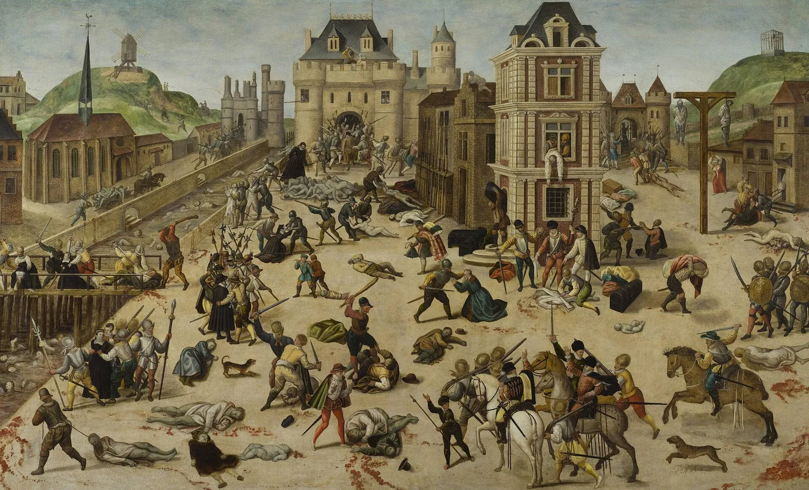
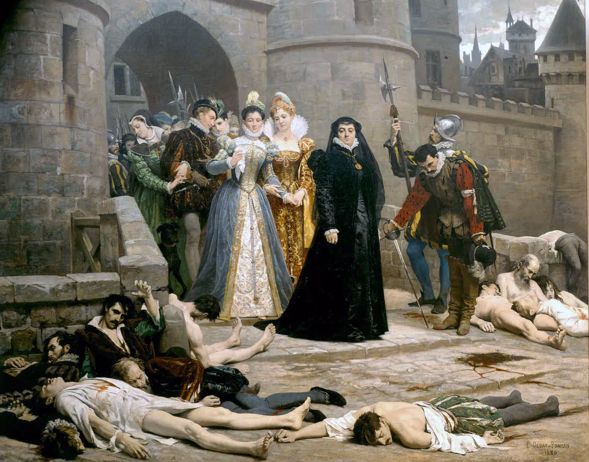
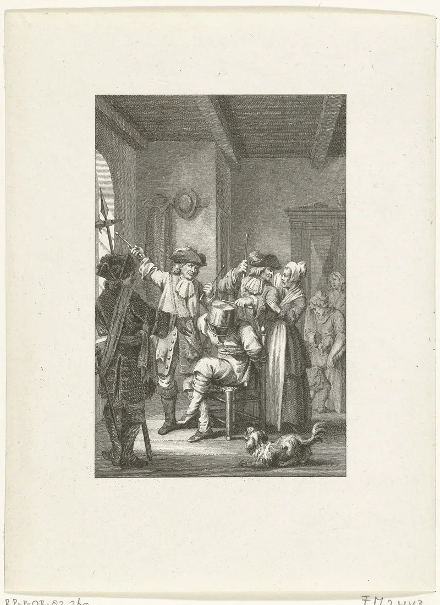
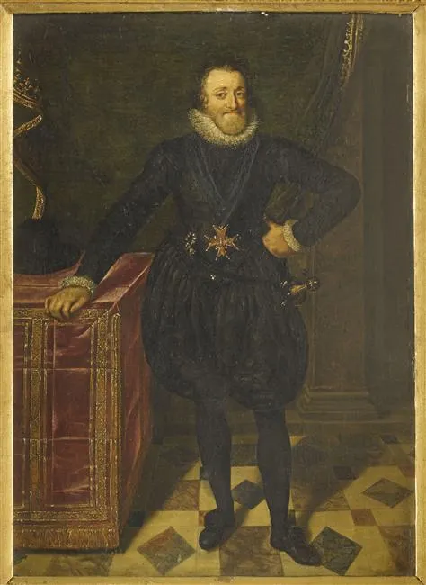

# What the French Wars of Religion tell us about today's culture war

*The St Bartholomew's Day Massacre, Paris, 24 August 1572. Painting: François Dubois (c. 1572–84), Musée cantonal des Beaux-Arts, Lausanne. Public domain, via [Wikimedia Commons](https://commons.wikimedia.org/wiki/File:La_masacre_de_San_Bartolom%C3%A9,_por_Fran%C3%A7ois_Dubois.jpg).*

After this month's Democratic victory, a lot of people I know are breathing a sigh of relief: *we're back, it's all okay*. I don't think it is. I think this is an interlude in an ongoing culture war — really a slow-motion civil war — that will run for a long time yet and resolve one way or the other.

The best guide I know to what we are living through is the last time this happened: the Wars of Religion in 16th-century France, the struggle between Protestants and Catholics. That was a culture war between **modernity and premodernity**. Ours is a culture war between **modernity and postmodernity**. The structure is strikingly similar — and so are the lessons.

## It was a paradigm war, not a doctrinal squabble

It is easy today to look back at the Wars of Religion and wonder how people could kill each other over theology. But consider what was at stake. If the most important thing in your world is being saved and going to heaven, then *how* that happens is the most important question there is. Are you saved through the Church — its priests, its sacraments, its hierarchy? Or are you saved by your own faith, through your own reading of the Bible? That is not a technicality. It is central and existential.

And underneath that question were two whole paradigms. **Protestantism carried the seeds of modernity**: it was individualist (salvation by faith alone, *sola fide*), egalitarian (the "priesthood of all believers"), and it democratised reason (read the book yourself, in your own language). **Catholicism represented premodernity**: hierarchical, institutional, mediated. Not unintelligent — the Church had brilliant minds — but it did not want ordinary people reading the Bible in the vernacular, and by the 1500s the vibrant scholasticism of the 13th century had largely ossified. It was against *democratising* reason.

One caution: modern did not yet mean secular. Calvin's Geneva was a theocracy. Secularisation comes much later. But the core features of modernity — the individual, equality, reason in everyone's hands — are there in Protestantism. And these ideas permeated beyond Protestants: Descartes was a Catholic, educated by Jesuits, and a thoroughgoing modernist.

## What happened: forty years of war

The short version:

- **The rise.** By around 1560 perhaps 10% of France was Protestant (the Huguenots) — a minority, but heavily concentrated among the nobility and the educated urban classes. A potential new elite, carrying a new paradigm.
- **The trigger.** In 1559 King Henry II died in a jousting accident, leaving a power vacuum: three weak boy kings, a regent queen mother (Catherine de' Medici), and rival noble factions. In 1562 the crown tried a compromise edict tolerating Protestant worship. Weeks later the ultra-Catholic Duke of Guise's men massacred Protestants at worship in Wassy, and war began.
- **The cycle.** Eight wars between 1562 and 1598. Each ended in a compromise peace; each compromise outraged the hardliners; war resumed.
- **The massacre.** In August 1572, a royal wedding meant to reconcile the two sides — the Protestant Henri of Navarre marrying the king's Catholic sister — brought the Protestant leadership to Paris. The crown ordered a "pre-emptive" strike on them. It became a popular massacre: neighbours killing neighbours, bodies in the Seine. Around 3,000 died in Paris and perhaps 10,000 or more across France. The Pope had a *Te Deum* sung.
- **The climax.** When the Protestant Henri of Navarre became heir to the throne in 1584, Catholic France erupted. A mass populist movement, the Catholic League, drove the king out of Paris. Two assassinations followed — the League's leader, then the king himself. Navarre became Henri IV, fought for years, and finally converted to Catholicism ("Paris is well worth a Mass") to end it.
- **The truce.** The Edict of Nantes (1598) granted Protestants freedom of conscience and limited worship. Not toleration as a principle — a pragmatic truce. Perhaps two to four million people had died from war, famine and disease.

*"A morning at the gates of the Louvre": Catherine de' Medici and the court inspect the dead after St Bartholomew's night. Painting: Édouard Debat-Ponsan (1880). Public domain, via [Wikimedia Commons](https://commons.wikimedia.org/wiki/File:Debat-Ponsan-matin-Louvre.jpg).*

## Lesson 1: the rise of the new manufactures reaction

The rise of Protestantism did not just meet existing Catholic conservatism. It *created* reaction. Ordinary Catholics who had never thought much about theology became militants. The Church reinvented itself as a fighting force: the Jesuits (founded 1540) as its shock troops of education and influence, the Inquisition and the Index of Forbidden Books, the Council of Trent redefining Catholicism explicitly *against* Protestantism. In France this became the Catholic League — mass, urban, populist, fired up by preachers and pamphlets, funded by Spain.

Note the irony: the Jesuits were extremely modern in their methods — schools, organisation, media, global reach — all in the service of defending the old order.

That is exactly what I see today. The rise of postmodern values provokes a reaction that is not simply "old conservatism" but something new and militant. And it comes in two flavours: religious and cultural traditionalists on one side, and on the other what Jeffrey Herf called **reactionary modernists** — people who embrace technology and the machinery of modernity while rejecting its liberal, egalitarian spirit. Think Musk and much of the tech right. Trump's genius, if that is the word, has been to knot these two together into a coalition that can win and that can resist the rising postmodern tide. (I've written about this before in [[Trump, Neo-fascism and the Crisis of Modernity]].)

## Lesson 2: each side polarises internally

The war was not two blocs. Within each camp there was intensifying polarisation:

- **Protestants** split between moderates seeking a settlement with the crown and militants — and, across Europe, the radical Reformation of the Anabaptists and the Münster commune.
- **Catholics** split between moderates — the so-called *Politiques*, people like Montaigne and Jean Bodin, who put civil peace above religious victory — and hardline reactionaries: the Guise family, the League, the assassins.

The same is happening now. The progressive side has its radicals and its reformers. The conservative side has its open, moderate traditionalists — and its counter-reformation. The conflict pulls each side's centre of gravity towards its extremes.

## Lesson 3: it oscillates — for a very long time

This is the point I most want to make. The arc bends, but it does not bend smoothly. Look at the swings:

| Toward toleration | Back toward repression |
|---|---|
| Edict of toleration (Jan 1562) | Massacre of Wassy (Mar 1562) and war |
| Generous peace (1570) and reconciliation wedding (1572) | St Bartholomew's Day Massacre (1572) |
| Very generous peace (1576) | Catholic League founded (1576) |
| A Protestant heir to the throne (1584) | League uprising; king driven from Paris (1588) |
| Protestant becomes king (1589) | He must convert to rule (1593) |
| **Edict of Nantes (1598)** | Henri IV assassinated (1610); Protestant strongholds crushed (1628–29) |
| | **Edict revoked (1685)**: Protestantism outlawed, forced conversions, 200,000 flee |
| Toleration restored (1787–89) | |

Notice how often the *generous* settlements triggered the worst backlash. And notice the timescale: the Edict of Nantes — the great "we won" moment — lasted 87 years before it was revoked. From the first persecutions (1534) to lasting toleration (1787–89) took more than two centuries.

*The dragonnades: soldiers billeted on Protestant households to terrorise them into converting, 1680s. Print, later 18th century. Rijksmuseum, CC0, via [Wikimedia Commons](https://commons.wikimedia.org/wiki/File:Dragonnades_in_Frankrijk,_ca._1681-1685,_RP-P-OB-82.260.jpg).*

## Lesson 4: the party can lose while the paradigm wins

Here is the twist. In France itself, the Protestants *lost*. By 1685 they were outlawed, converted or in exile. And yet modernity won. It won through the Protestant powers — the Dutch Republic, England, Prussia — which became the leading modern states, enriched by Huguenot refugees. And it won inside Catholic France itself, through Descartes, the Enlightenment and, eventually, the Revolution.

And the settlement that finally ended the killing came not from either side's victory but from the third position: the *Politiques*' idea of a sovereign state standing above the sects.

## So: where are we now?

If the analogy holds — and like all analogies it is imperfect — then:

- We are in a deep paradigm conflict, not a normal political cycle. New media like social media amplifies it, just as the printing press amplified the Reformation, but it is secondary. The root is the clash of paradigms — what I call the [[metacrisis]].
- The rise of the new will keep provoking reaction, and that reaction will be resourceful and modern in its methods.
- Both sides will keep polarising internally.
- There will be many oscillations. A win, even a big one, is not a resolution. Generous victories may provoke the fiercest backlash.
- The outcome is not guaranteed. A new paradigm can lose for a long time in a given place. It can also win in ways neither faction expects.

So, yes, enjoy the relief. But this is not the end. It is the Edict of Saint-Germain, not the Edict of Nantes — and even Nantes did not last. The real question is not who wins the next election but whether we can find, faster this time and with far less bloodshed, the deeper settlement that lets a new paradigm emerge. That is what I mean by a [[Second Renaissance]].

*Henri IV, the Protestant who became king, converted, and issued the Edict of Nantes. Assassinated by a Catholic zealot in 1610. Painting: Frans Pourbus the Younger (1610), Musée Condé. Public domain, via [Wikimedia Commons](https://commons.wikimedia.org/wiki/File:Portrait_d%27Henri_IV_-_Frans_Pourbus_-_Mus%C3%A9e_Cond%C3%A9.jpg).*
